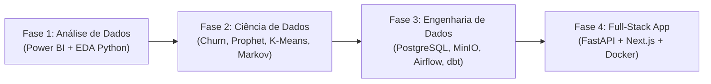

# 📋 PRD Geral de Tarefas — Grão Nobre Analytics Platform

> Documento de Requisitos de Produto (PRD) e Especificação Técnica para **todas as tasks e subtasks** do projeto **Grão Nobre Analytics Platform**, abrangendo as 4 fases do roadmap (`docs/ROADMAP.md`), regras de negócio (`docs/BUSINESS_RULES.md`), dicionário de dados (`docs/DATA_DICTIONARY.md`) e catálogo DAX (`powerbi/medidas_dax.md`).

---

## 🧭 Visão Arquitetural das Entregas

> [!IMPORTANT]
> **Padrões Globais de Qualidade (Aplicáveis a todas as tasks):**
> - **Dados:** Encoding UTF-8, datas ISO 8601 (`YYYY-MM-DD`), valores monetários com 2 casas decimais (`DECIMAL(10,2)`), integridade referencial 100% entre `fato_*` e `dim_*` e zero `NULL` em chaves obrigatórias.
> - **Power BI:** Medidas exclusivas na tabela `_Medidas` com prefixo de área (`Vendas |`, `Mkt |`, `Clientes |`, `Atd |`, `Est |`) e tema oficial `powerbi/grao_nobre_theme.json`.
> - **Código & Git:** Python com PEP 8, type hints e Google docstrings; SQL em `snake_case` com CTEs; Conventional Commits em PT-BR (`feat:`, `fix:`, `docs:`, `data:`).

---

# 📊 FASE 1 — Análise de Dados

## Sprint 1.1 — Fundação (Tasks 1.1.1 a 1.1.8)

### `1.1.1` Definir Regras de Negócio (`docs/BUSINESS_RULES.md`)
- **Objetivo:** Formalizar a identidade da Grão Nobre Cafés Especiais, canais de operação (`WEB01` + `LOJ01`, `LOJ02`, `LOJ03`), precificação, margens por categoria, regras de frete, RFM, Churn, SLA de atendimento e metas financeiras.
- **Requisitos & Entregáveis:** Documento `docs/BUSINESS_RULES.md` contendo metas de Receita Bruta (R$ 200k/mês), Margem Bruta (≥ 55%), ROAS (≥ 4,0x), CAC (< R$ 45), LTV:CAC (> 3:1) e NPS (≥ 70).
- **Critérios de Aceite:** Todas as fórmulas de KPIs e parâmetros de sazonalidade documentados sem ambiguidades.

### `1.1.2` Criar Dicionário de Dados (`docs/DATA_DICTIONARY.md`)
- **Objetivo:** Especificar o modelo dimensional Star Schema com 6 dimensões e 4 tabelas fato.
- **Requisitos & Entregáveis:** Documento `docs/DATA_DICTIONARY.md` detalhando tipos, PKs, FKs, nulabilidade e granularidade (*grain*) de `dim_clientes`, `dim_produtos`, `dim_canais_marketing`, `dim_campanhas`, `dim_lojas`, `dim_calendario`, `fato_vendas`, `fato_marketing`, `fato_atendimento` e `fato_estoque`.
- **Critérios de Aceite:** Diagrama ER completo e padrões de ID (`CLI###`, `PRD##`, `PED####`, `CAM###`, `LOJ##`, `CAN##`) definidos.

### `1.1.3` Criar Arquitetura Técnica (`docs/ARCHITECTURE.md`)
- **Objetivo:** Definir a stack tecnológica, fluxo de dados e arquitetura das 4 fases do projeto.
- **Requisitos & Entregáveis:** Documento `docs/ARCHITECTURE.md` com diagramas Mermaid, arquitetura Medalhão (Bronze/Silver/Gold), endpoints planejados da API e convenções de código.

### `1.1.4` & `1.1.5` & `1.1.6` Repositório GitHub, MCPs e Projeto no Linear
- **Objetivo:** Estruturar governança, versionamento e gestão ágil do projeto.
- **Entregáveis:** Repositório GitHub configurado, integrações MCP (GitHub e Linear) operacionais e backlog populado via `scripts/populate_linear.py`.

### `1.1.7` Gerar Dados Sintéticos Robustos (`scripts/generate_data.py`)
- **Objetivo:** Gerar base sintética realista em `data/raw/*.csv` usando `Faker (pt_BR)` e distribuições estatísticas aderentes ao negócio.
- **Requisitos Técnicos:**
  - Mínimo de 500+ clientes (550 gerados), 25+ produtos, 7.200+ itens de venda, 365+ dias de marketing, estoque e atendimento.
  - Sazonalidade aplicada (alta em Maio, Junho, Julho, Agosto, Novembro e Dezembro; baixa em Janeiro e Fevereiro).
- **Critérios de Aceite:** 10 arquivos CSV gerados em UTF-8 sem quebras de integridade referencial.

### `1.1.8` Criar Script de Validação de Dados (`scripts/validate_data.py`)
- **Objetivo:** Auditar automaticamente a qualidade dos 10 CSVs gerados antes da ingestão no Power BI e notebooks.
- **Requisitos Técnicos:** Checagem de PKs únicas, FKs válidas, ausência de `NULL` em campos obrigatórios, validação de domínio e precisão decimal.
- **Critérios de Aceite:** Execução de `scripts/validate_data.py` retornando 100% de aprovação nos 16.647+ registros.

---

## Sprint 1.2 — Dashboard Power BI (Tasks 1.2.1 a 1.2.9)

### `1.2.1` Importar Dados no Power BI Desktop
- **Objetivo:** Conectar e tipar os 10 arquivos CSV de `data/raw/` no Power Query.
- **Requisitos Técnicos:**
  - Configurar origem UTF-8 (código 65001) e separador vírgula.
  - Tipar colunas monetárias como `Número Decimal Fixo (Moeda)`, datas como `Data` e quantidades como `Número Inteiro`.
  - Aplicar o tema visual `powerbi/grao_nobre_theme.json`.
- **Critérios de Aceite:** 10 tabelas carregadas sem erros de truncamento ou conversão em nenhuma linha.

---

### `1.2.2` Criar Modelo Dimensional no Power BI (Star Schema)
- **Objetivo:** Estruturar os relacionamentos `1:N` com direção de filtro único (Dimensão ➔ Fato).
- **Requisitos Técnicos:**
  - Marcar `dim_calendario` como **Tabela de Datas Oficial** (chave `data`).
  - Ordenar `dim_calendario[nome_mes]` pela coluna `dim_calendario[mes]` e `nome_dia_semana` por `dia_semana_num`.
  - Ocultar chaves estrangeiras (`*_id`) nas tabelas fato na exibição de relatório para evitar uso acidental.
- **Critérios de Aceite:** Diagrama em estrela limpo e funcional conforme `powerbi/README.md`.

---

### `1.2.3` Criar Catálogo de Medidas DAX (`_Medidas`)
- **Objetivo:** Centralizar todas as regras de cálculo na tabela dedicada `_Medidas`.
- **Requisitos Técnicos:** Implementar todas as medidas documentadas em `powerbi/medidas_dax.md` organizadas em pastas de exibição (`01. Vendas`, `02. Marketing`, `03. Clientes`, `04. Atendimento`, `05. Estoque`).
- **Critérios de Aceite:** Nenhuma coluna numérica implícita utilizada nos visuais; todas as divisões protegidas por `DIVIDE()`.

---

### `1.2.4` [YOH-16] Dashboard — Visão Executiva (Página 1)
- **Objetivo do Produto:** Oferecer ao C-Level uma visão consolidada de 360° sobre Faturamento, Margem, Canais, Categorias, ROAS e Saúde da Base.
- **Perguntas de Negócio Respondidas:**
  1. Estamos atingindo a meta de Receita e Margem Bruta (≥ 55%)?
  2. Como a receita e o custo evoluem mês a mês frente à sazonalidade?
  3. Qual é a representatividade do E-commerce vs. Lojas Físicas e quais categorias puxam o lucro?
- **Subtasks Vinculadas (YOH-19 a YOH-23):**
  - **`YOH-19` — `[PBI] Executivo: Cartões de KPIs Principais`:**
    - **Visual:** Novo Cartão (Card Visual) com 5 a 8 indicadores no topo.
    - **Medidas:** `[Vendas | Receita Líquida]`, `[Vendas | Margem Bruta %]` (meta ≥ 55%), `[Vendas | Ticket Médio]`, `[Mkt | ROAS]` (meta ≥ 4,0x) e `[Clientes | Ativos]`.
    - **Estilo:** Fundo `#F5F0EB`, rótulo principal em `#2D1810`, indicador de meta atingida em `#2ECC71` e abaixo da meta em `#E74C3C`.
  - **`YOH-20` — `[PBI] Executivo: Gráfico de Linhas - Evolução Temporal de Vendas`:**
    - **Visual:** Gráfico de Linhas / Colunas e Linhas.
    - **Eixo X:** `dim_calendario[ano]` > `dim_calendario[nome_mes]`.
    - **Eixo Y:** `[Vendas | Receita Líquida]` (`#2D1810`) vs. `[Vendas | Custo Total]` (`#C4956A`).
    - **Tooltips:** `[Vendas | Lucro Bruto]`, `[Vendas | Margem Bruta %]` e `[Vendas | Qtd Pedidos]`.
  - **`YOH-21` — `[PBI] Executivo: Gráfico de Barras - Receita e Margem por Categoria`:**
    - **Visual:** Gráfico de Barras Horizontais Agrupadas.
    - **Eixo Y:** `dim_produtos[categoria]`.
    - **Eixo X:** `[Vendas | Receita Líquida]`.
    - **Formatação Condicional / Tooltip:** `[Vendas | Margem Bruta %]` e `[Vendas | Lucro Bruto]`.
  - **`YOH-22` — `[PBI] Executivo: Gráfico Donut - Receita por Canal de Venda`:**
    - **Visual:** Gráfico de Rosca (Donut Chart).
    - **Legenda:** `dim_lojas[tipo]` (com drill-down para `dim_lojas[nome_loja]`).
    - **Valores:** `[Vendas | Receita Líquida]`.
  - **`YOH-23` — `[PBI] Executivo: Barra Superior de Filtros e Segmentadores`:**
    - **Visual:** Segmentadores em lista suspensa (dropdown) ou botões horizontais no cabeçalho.
    - **Campos:** `dim_calendario[ano]`, `dim_calendario[nome_mes]`, `dim_clientes[regiao]` e `dim_lojas[nome_loja]`.
- **Critérios de Aceite da Página 1:** Todos os 5 blocos visuais sincronizados, sem rolagem vertical, respeitando a paleta Grão Nobre e ordenação cronológica dos meses.

---

### `1.2.5` Dashboard — Vendas Detalhado (Página 2)
- **Objetivo do Produto:** Permitir análise tática e operacional de rentabilidade por SKU, elasticidade preço-volume, distribuição geográfica e meios de pagamento.
- **Perguntas de Negócio Respondidas:**
  1. Quais produtos são "Estrelas" (alto giro e alta margem) e quais corroem a margem?
  2. Qual é o desempenho regional por UF/Cidade e a diferença de ticket médio entre praças?
  3. Qual é a participação de cada meio de pagamento (PIX, Crédito, Débito, Boleto) e o peso do frete?
- **Subtasks Vinculadas (YOH-24 a YOH-27):**
  - **`YOH-24` — `[PBI] Vendas: Matriz Hierárquica de Produtos e Margens`:**
    - **Visual:** Matriz com drill-down nas linhas: `dim_produtos[categoria]` ➔ `subcategoria` ➔ `nome_produto`.
    - **Valores:** `[Vendas | Qtd Itens Vendidos]`, `[Vendas | Receita Bruta]`, `[Vendas | Total Descontos]`, `[Vendas | Receita Líquida]`, `[Vendas | Custo Total]`, `[Vendas | Lucro Bruto]` e `[Vendas | Margem Bruta %]` (com barra de dados e ícone de alerta se abaixo da margem alvo da categoria).
  - **`YOH-25` — `[PBI] Vendas: Dispersão (Scatter Plot) - Preço vs Volume vs Lucro`:**
    - **Visual:** Gráfico de Dispersão (Quadrantes de Portfólio).
    - **Valores:** Detalhes = `dim_produtos[nome_produto]`; Eixo X = `AVERAGE(dim_produtos[preco_venda])`; Eixo Y = `[Vendas | Qtd Itens Vendidos]`; Tamanho da Bolha = `[Vendas | Lucro Bruto]`; Legenda = `dim_produtos[categoria]`.
    - **Linhas de Média:** Linhas tracejadas de média no Eixo X e Eixo Y dividindo o gráfico em 4 quadrantes.
  - **`YOH-26` — `[PBI] Vendas: Desempenho Regional por Estado e Região`:**
    - **Visual:** Gráfico de Barras Horizontais ou Mapa Coroplético com Drill-Down (`dim_clientes[regiao]` ➔ `estado` ➔ `cidade`).
    - **Métricas:** `[Vendas | Receita Líquida]`, `[Vendas | Ticket Médio]` e `[Vendas | Frete Total]`.
  - **`YOH-27` — `[PBI] Vendas: Colunas Empilhadas - Distribuição por Meio de Pagamento`:**
    - **Visual:** Gráfico de Colunas 100% Empilhadas ou Empilhadas por mês.
    - **Eixo X:** `dim_calendario[nome_mes]`; **Eixo Y:** `[Vendas | Receita Líquida]`; **Legenda:** `fato_vendas[meio_pagamento]` (PIX, Cartão de Crédito, Cartão de Débito, Boleto).
- **Critérios de Aceite da Página 2:** Matriz expansível até nível de SKU (`PRD##`), quadrantes de dispersão claros e filtro cruzado entre mapa, matriz e meios de pagamento.

---

### `1.2.6` Dashboard — Marketing Performance (Página 3)
- **Objetivo do Produto:** Monitorar o funil de aquisição digital, eficiência do orçamento mensal (R$ 23.800/mês) e retorno sobre investimento em mídia (ROAS e CPA) por canal e campanha.
- **Perguntas de Negócio Respondidas:**
  1. Onde estão os gargalos do funil digital (Impressões ➔ Cliques ➔ Sessões ➔ Conversões)?
  2. Quais canais (Google Search, Shopping, Instagram, Facebook, Email, SEO, Influenciadores) batem suas metas de CPA e ROAS?
  3. Qual foi o resultado real das campanhas sazonais (Black Friday, Inverno, Dia das Mães)?
- **Subtasks Vinculadas (YOH-28 a YOH-32):**
  - **`YOH-28` — `[PBI] Marketing: Cartões de KPIs de Mídia e Performance`:**
    - **Medidas:** `[Mkt | Investimento Total]`, `[Mkt | Receita Atribuída]`, `[Mkt | ROAS]` (meta ≥ 4,0x), `[Mkt | CPA]`, `[Mkt | CTR %]` (meta > 3,0%), `[Mkt | CPC Médio]` (meta < R$ 1,50) e `[Clientes | CAC Médio]` (meta < R$ 45).
  - **`YOH-29` — `[PBI] Marketing: Funil de Conversão do Tráfego Digital`:**
    - **Visual:** Gráfico de Funil exibindo: `1. [Mkt | Impressões]` ➔ `2. [Mkt | Cliques]` ➔ `3. SUM(fato_marketing[sessoes_site])` ➔ `4. [Mkt | Conversões]`, com percentual de conversão entre etapas.
  - **`YOH-30` — `[PBI] Marketing: Barras Agrupadas - Investimento vs Receita por Canal`:**
    - **Visual:** Gráfico de Barras Agrupadas.
    - **Eixo Y:** `dim_canais_marketing[canal_nome]`; **Eixo X:** `[Mkt | Investimento Total]` vs. `[Mkt | Receita Atribuída]`; **Tooltips:** `[Mkt | ROAS]` vs. `dim_canais_marketing[roas_alvo]` e `[Mkt | CPA]` vs. `dim_canais_marketing[cpa_alvo]`.
  - **`YOH-31` — `[PBI] Marketing: Linhas Eixo Duplo - Investimento vs ROAS Diário`:**
    - **Visual:** Colunas Agrupadas e Linha.
    - **Eixo X:** `dim_calendario[data]`; **Colunas:** `[Mkt | Investimento Total]`; **Linha:** `[Mkt | ROAS]` com linha constante de referência em `4,0x`.
  - **`YOH-32` — `[PBI] Marketing: Tabela de Desempenho de Campanhas Sazonais`:**
    - **Visual:** Tabela/Matriz detalhando `dim_campanhas[nome_campanha]`, `tipo_campanha`, `status`, `budget_campanha`, `[Mkt | Investimento Total]`, `[Mkt | Conversões]`, `[Mkt | CPA]`, `[Mkt | Receita Atribuída]` e `[Mkt | ROAS]` ordenado decrescentemente por ROAS.
- **Critérios de Aceite da Página 3:** Comparação clara entre meta planejada do canal (`roas_alvo` / `cpa_alvo`) e realizado, com destaque visual para canais ineficientes.

---

### `1.2.7` Dashboard — Clientes & Retenção (Página 4)
- **Objetivo do Produto:** Acompanhar a saúde da carteira de clientes (CRM), distribuição de valor (Bronze, Prata, Ouro, Diamante), risco de evasão (Churn) e unit economics (`LTV / CAC`).
- **Perguntas de Negócio Respondidas:**
  1. Qual percentual da base está Ativa, Em Risco (61-120d), Inativa (121-180d) ou Churned (>180d)?
  2. Qual perfil demográfico (faixa etária, gênero, região) concentra os clientes Ouro e Diamante?
  3. Quais canais de aquisição trazem clientes com maior LTV e melhor relação LTV/CAC?
- **Subtasks Vinculadas (YOH-33 a YOH-36):**
  - **`YOH-33` — `[PBI] Clientes: Cartões de Saúde da Base (CRM & Churn)`:**
    - **Medidas:** `[Clientes | Total Base]`, `[Clientes | Ativos]`, `[Clientes | Em Risco]`, `[Clientes | Churned]`, `[Clientes | Taxa de Churn %]`, `[Clientes | LTV Médio]` e `[Clientes | LTV / CAC Ratio]` (meta > 3,0x).
  - **`YOH-34` — `[PBI] Clientes: Gráfico Donut - Distribuição de Churn`:**
    - **Visual:** Gráfico de Rosca por `dim_clientes[status_churn]` com paleta semântica: Ativo (`#2ECC71`), Em risco (`#E8B931`), Inativo (`#C4956A`) e Churned (`#E74C3C`).
  - **`YOH-35` — `[PBI] Clientes: Colunas 100% Empilhadas - Faixa Etária vs Segmento de Valor`:**
    - **Visual:** Colunas 100% Empilhadas cruzando `dim_clientes[faixa_etaria]` no Eixo X com `dim_clientes[segmento_valor]` (Bronze, Prata, Ouro, Diamante) na legenda e `[Clientes | Total Base]` nos valores.
  - **`YOH-36` — `[PBI] Clientes: Barras Horizontais - LTV Médio e LTV/CAC por Canal`:**
    - **Visual:** Gráfico de Barras Horizontais por `dim_clientes[canal_aquisicao]` medindo `[Clientes | LTV Médio]` e exibindo `[Clientes | LTV / CAC Ratio]` nos rótulos/tooltips.
- **Critérios de Aceite da Página 4:** Segmentação de clientes funcional permitindo filtrar a lista de clientes "Em risco" dos segmentos Ouro e Diamante para ações de retenção.

---

### `1.2.8` Dashboard — Estoque & Operações (Página 5)
- **Objetivo do Produto:** Monitorar níveis de inventário diário (`fato_estoque`), prevenir rupturas (*stockouts*), controlar cobertura em dias e garantir giro saudável nas lojas físicas e CD do E-commerce.
- **Perguntas de Negócio Respondidas:**
  1. Quantos e quais SKUs estão em ruptura (`qtd_estoque = 0`) ou abaixo do estoque mínimo (`< 20 unidades`) hoje?
  2. Qual é a cobertura média de estoque (em dias) por loja e por categoria?
  3. O ritmo de reposição (`qtd_recebida_dia`) acompanha a demanda diária (`qtd_vendida_dia`)?
- **Novas Medidas DAX Requeridas em `_Medidas`:**
  - `Est | Qtd em Estoque Atual` (último snapshot disponível via `LASTDATE(dim_calendario[data])`)
  - `Est | SKUs em Ruptura` (`CALCULATE(DISTINCTCOUNT(fato_estoque[produto_id]), fato_estoque[is_ruptura] = TRUE())`)
  - `Est | SKUs Abaixo do Mínimo` (`CALCULATE(DISTINCTCOUNT(fato_estoque[produto_id]), fato_estoque[is_abaixo_minimo] = TRUE())`)
  - `Est | Taxa de Ruptura %` (`DIVIDE([Est | SKUs em Ruptura], DISTINCTCOUNT(fato_estoque[produto_id]), 0)`)
  - `Est | Cobertura Média (Dias)` (`AVERAGE(fato_estoque[dias_cobertura])`)
- **Escopo de Visuais da Página 5:**
  1. **Cards de Alerta Operacional:** `Est | Qtd em Estoque Atual`, `Est | SKUs em Ruptura` (alerta `#E74C3C`), `Est | SKUs Abaixo do Mínimo` (alerta `#E8B931`), `Est | Cobertura Média (Dias)`.
  2. **Matriz Crítica de Reposição (SKU x Loja):** Tabela com `dim_produtos[nome_produto]`, `dim_lojas[nome_loja]`, estoque atual, cobertura em dias e flag visual de status (`Crítico / Ruptura`, `Atenção < 20 un`, `Saudável`).
  3. **Evolução Diária de Estoque vs. Vendas e Recebimentos (Gráfico de Linhas/Área):** Histórico ao longo do tempo de `qtd_estoque`, `qtd_vendida_dia` e `qtd_recebida_dia`.
  4. **Cobertura de Estoque por Categoria e Unidade (Gráfico de Barras Agrupadas):** Comparação de `dias_cobertura` entre `LOJ01`, `LOJ02`, `LOJ03` e `WEB01`.
- **Critérios de Aceite da Página 5:** Medidas de saldo de estoque utilizando função semi-aditiva (`LASTDATE` / `LASTNONBLANK`) para não somar snapshots de dias diferentes indevidamente.

---

### `1.2.9` Dashboard — Atendimento & CX (Página 6)
- **Objetivo do Produto:** Acompanhar a qualidade do suporte ao cliente (`fato_atendimento`), cumprimento dos SLAs de primeira resposta e resolução por canal, motivos de contato e evolução do NPS.
- **Perguntas de Negócio Respondidas:**
  1. O NPS da Grão Nobre está atingindo a meta de excelência (≥ 70)?
  2. Quais canais (WhatsApp, Email, Chat, Instagram DM, Telefone) estão estourando o SLA de resposta?
  3. Quais são as principais dores dos clientes (`Reclamação de qualidade`, `Atraso na entrega`, `Troca/Devolução`)?
- **Medidas DAX Utilizadas / Adicionais em `_Medidas`:**
  - `[Atd | Total Ocorrências]`, `[Atd | Tempo Médio Resposta (min)]`, `[Atd | Tempo Médio Resolução (min)]`, `[Atd | NPS Médio]`
  - `Atd | NPS Score` (`(% Promotores [nota 9-10] - % Detratores [nota 0-6]) * 100`)
  - `Atd | % Tickets Resolvidos` e `Atd | % Dentro do SLA` (comparando `tempo_resposta_min` com a regra de SLA de cada canal: WhatsApp ≤ 15m, Chat ≤ 2m, Telefone ≤ 1m, Instagram ≤ 30m, Email ≤ 240m).
- **Escopo de Visuais da Página 6:**
  1. **Cards de CX:** `Atd | Total Ocorrências`, `Atd | NPS Score` (meta ≥ 70), `Atd | Tempo Médio Resposta (min)`, `Atd | Tempo Médio Resolução (min)` e `Atd | % Dentro do SLA`.
  2. **Gráfico de Barras — Volume e Tempo de Resolução por Tipo de Ocorrência:** Destacando `Atraso na entrega` e `Reclamação de qualidade` (Prioridade Alta).
  3. **Matriz de Performance por Canal de Atendimento:** Comparando volume de tickets, SLA alvo vs. tempo real de resposta e nível de satisfação (`Satisfeito`, `Neutro`, `Insatisfeito`).
  4. **Composição do NPS ao Longo do Tempo (Colunas 100% Empilhadas + Linha):** Proporção mensal de Promotores (`#2ECC71`), Neutros (`#E8B931`) e Detratores (`#E74C3C`) com linha do NPS Score.
- **Critérios de Aceite da Página 6:** Cálculo oficial de NPS (% Promotores - % Detratores) validado e alertas visuais para tickets abertos fora do SLA.

---

## Sprint 1.3 — Análise Exploratória com Python (Tasks 1.3.1 a 1.3.5)

### `1.3.1` EDA de Vendas (`notebooks/01_eda_vendas.ipynb`)
- **Objetivo:** Realizar análise exploratória estatística profunda sobre `fato_vendas`, `dim_produtos` e `dim_lojas`.
- **Escopo Analítico:**
  - Estatísticas descritivas, distribuição de ticket médio (E-commerce vs. Lojas Físicas) e teste de hipótese de diferença de médias.
  - Decomposição de sazonalidade mensal e semanal (impacto de Dia das Mães, Inverno, Black Friday e Natal).
  - Curva ABC (Pareto 80/20) de produtos por receita líquida e por lucro bruto.
  - Análise do impacto dos descontos progressivos (5%, 10%, 15%) e frete grátis (> R$ 150) na margem real.
  - Identificação de anomalias/outliers controlados presentes na base.
- **Critérios de Aceite:** Notebook executável do início ao fim sem erros, com células Markdown explicando cada hipótese, gráficos padronizados na paleta Grão Nobre e seção final de recomendações de negócio.

### `1.3.2` EDA de Marketing (`notebooks/02_eda_marketing.ipynb`)
- **Objetivo:** Avaliar eficiência de mídia, correlação entre investimento e vendas e performance de campanhas em `fato_marketing`.
- **Escopo Analítico:**
  - Análise de eficiência por canal: ROAS, CPA, CTR, CPC, CPM e Taxa de Conversão vs. metas de `dim_canais_marketing`.
  - Curvas de retorno marginal decrescente (saturação de investimento diário vs. receita atribuída).
  - Análise de performance por tipo de campanha (`Sazonal`, `Flash Sale`, `Lançamento`, `Remarketing`, `Fidelidade`).
  - Comportamento de tráfego (`sessoes_site`, `bounce_rate`, `novos_leads`) ao longo do ano.
- **Critérios de Aceite:** Visualizações comparativas de budget planejado vs. realizado e recomendações práticas de realocação de orçamento.

### `1.3.3` Análise de Coorte / Cohort Analysis (`notebooks/03_cohort_analysis.ipynb`)
- **Objetivo:** Medir a retenção mensal de clientes ao longo do tempo a partir do mês da primeira compra (safra/coorte).
- **Escopo Analítico:**
  - Construção da matriz de retenção de clientes (%) por safra de aquisição (`cohort_month` x `cohort_index`).
  - Construção da matriz de retenção de receita líquida (*Net Dollar Retention*) e ticket médio por safra.
  - Comparativo de retenção entre clientes adquiridos em meses promocionais (ex: Black Friday) vs. meses regulares.
  - Comparativo de retenção por canal de aquisição (`canal_aquisicao`).
- **Critérios de Aceite:** Heatmap de coorte legível em Seaborn/Plotly com interpretação clara sobre o ciclo de recompra de 90/180 dias.

### `1.3.4` Segmentação RFM (`notebooks/04_rfm_analysis.ipynb`)
- **Objetivo:** Classificar os 550 clientes da Grão Nobre segundo Recência, Frequência e Valor Monetário conforme `docs/BUSINESS_RULES.md`.
- **Escopo Analítico:**
  - Cálculo exato de **R** (dias desde última compra), **F** (nº de pedidos em 12 meses) e **M** (valor líquido total em 12 meses).
  - Atribuição de notas de 1 a 5 (quintis e regras de corte de negócio) e criação de segmentos acionáveis (*Campeões*, *Clientes Fiéis*, *Potenciais Fiéis*, *Em Risco*, *Não Posso Perder*, *Hibernando*).
  - Cruzamento dos segmentos RFM com `segmento_valor` (Bronze/Prata/Ouro/Diamante) e `status_churn`.
  - Plano de ação de CRM (campanhas de reativação, upsell e fidelidade) para cada segmento.
- **Critérios de Aceite:** Tabela final exportada em `data/processed/clientes_rfm.csv` e gráficos de distribuição de valor por segmento RFM.

### `1.3.5` Relatório Executivo Final da Fase 1 (`docs/FASE1_REPORT.md`)
- **Objetivo:** Consolidar os principais diagnósticos, insights dos 4 notebooks e resultados do Dashboard Power BI em um relatório executivo de portfólio.
- **Critérios de Aceite:** Documento estruturado com Sumário Executivo, Diagnóstico por Área (Vendas, Marketing, Clientes, Operações), Top 10 Insights Quantificados e Recomendações Estratégicas para a Fase 2.

---

# 🤖 FASE 2 — Ciência de Dados & Machine Learning

## Sprint 2.1 — Feature Engineering (Tasks 2.1.1 a 2.1.4 / Linear `[ML-01]`)

### `2.1.1` & `2.1.2` Feature Store de Clientes e Variáveis RFM Automatizadas (`notebooks/05_feature_engineering.ipynb`)
- **Objetivo:** Transformar o histórico transacional (`fato_vendas`, `fato_atendimento`) em uma tabela analítica no nível cliente (*Customer Analytical Base Table - ABT*).
- **Features Obrigatórias:**
  - `recencia_dias`, `frequencia_pedidos`, `monetario_total`, `ticket_medio_cliente`, `qtd_media_itens_pedido`.
  - `pct_pedidos_com_desconto`, `desconto_medio_utilizado`, `frete_medio_pago`.
  - `diversidade_categorias` (nº de categorias distintas compradas), `categoria_favorita`, `canal_preferido` (E-commerce vs. Loja Física).
  - `tempo_entre_compras_medio` (interpurchase time), `qtd_tickets_atendimento`, `nota_nps_media`, `reclamacao_qualidade_flag`.
- **Entregável:** Notebook `05_feature_engineering.ipynb` e dataset `data/processed/customer_feature_store.csv`.

### `2.1.3` & `2.1.4` Pipeline de Preprocessamento e Análise de Correlação
- **Objetivo:** Preparar variáveis numéricas e categóricas para modelagem supervisionada e não supervisionada, evitando *data leakage*.
- **Requisitos Técnicos:**
  - `ColumnTransformer` / `Pipeline` do Scikit-learn com `StandardScaler` / `MinMaxScaler` e `OneHotEncoder`.
  - Análise de multicolinearidade (VIF e Matriz de Correlação de Spearman/Pearson) e seleção de features.

---

## Sprint 2.2 — Modelos Preditivos (Tasks 2.2.1 a 2.2.4 / Linear `[ML-02]` a `[ML-06]`)

### `2.2.1` [ML-02 & ML-03] Modelo de Previsão de Churn + Explicabilidade SHAP (`notebooks/06_churn_model.ipynb`)
- **Objetivo:** Prever a probabilidade de evasão de cada cliente e identificar os principais vetores de churn.
- **Requisitos Técnicos:**
  - **Target:** `is_churned` (binário). Definir janela de observação vs. janela de performance para evitar *target leakage*.
  - **Algoritmos comparados:** Logistic Regression (baseline), Random Forest, XGBoost / LightGBM com `StratifiedKFold` e tratamento de desbalanceamento (`class_weight` / SMOTE).
  - **Explicabilidade (`[ML-03]`):** SHAP Values (*Beeswarm Plot*, *Bar Plot* global e *Waterfall Plot* individual).
- **Meta de Performance:** `F1-Score > 0.80` e `ROC-AUC > 0.82`.

### `2.2.2` [ML-04] Previsão de Demanda com Séries Temporais (`notebooks/07_demand_forecast.ipynb`)
- **Objetivo:** Projetar a demanda diária e semanal de vendas para os próximos 90 dias para otimizar compras e torra de café.
- **Requisitos Técnicos:**
  - **Modelos:** Meta `Prophet` e `SARIMAX` / `Holt-Winters` (Statsmodels).
  - **Componentes:** Sazonalidade semanal, sazonalidade anual (pico de inverno em Junho/Julho) e regressores exógenos de feriados/eventos (`Black Friday`, `Dia das Mães`, `Dia dos Namorados`, `Dia dos Pais`, `Natal`).
  - **Backtesting:** Validação temporal (*Time Series Split* / *Rolling Origin*) nos últimos 60-90 dias.
- **Meta de Performance:** `MAPE < 15%` (alvo ótimo `< 10%`) e reporte de `RMSE` e `MAE`.

### `2.2.3` [ML-05] Segmentação por Clustering Não Supervisionado (`notebooks/08_clustering.ipynb`)
- **Objetivo:** Descobrir personas comportamentais naturais na base de clientes além das faixas fixas de LTV.
- **Requisitos Técnicos:**
  - **Algoritmos:** K-Means (com avaliação via *Elbow Method* e *Silhouette Score*) e comparação com DBSCAN ou Agglomerative Clustering.
  - **Redução de Dimensionalidade:** PCA 2D/3D para visualização da separação dos clusters.
  - **Perfilamento de Personas:** Nomeação executiva dos clusters (ex: *VIP Apaixonados por Café*, *Presenteadores Sazonais*, *Caçadores de Desconto*, *Clientes Frios*).
- **Meta de Performance:** `Silhouette Score > 0.50`.

### `2.2.4` [ML-06] Modelo de Atribuição Multi-Touch com Cadeias de Markov (`notebooks/09_attribution.ipynb`)
- **Objetivo:** Avaliar a contribuição real de cada canal de marketing ao longo da jornada de conversão, superando o viés do modelo *Last Click*.
- **Requisitos Técnicos:**
  - Construção da matriz de transição de estados entre touchpoints de canais (`Início` ➔ `Canais...` ➔ `Conversão` / `Abandono`).
  - Cálculo do **Removal Effect** (efeito de remoção) de cada canal na probabilidade total de conversão.
  - Comparação das receitas atribuídas entre os modelos: *First Click*, *Last Click*, *Linear*, *Time Decay* e *Markov Chain*.
- **Critérios de Aceite:** Recomendação quantificada de otimização do budget mensal de R$ 23.800 entre os canais.

---

## Sprint 2.3 — Experimentação e Deploy de ML (Tasks 2.3.1 a 2.3.4 / Linear `[ML-07]`)

### `2.3.1` Framework de A/B Testing (`notebooks/10_ab_testing.ipynb`)
- **Objetivo:** Estruturar o desenho e avaliação estatística de testes A/B para campanhas de marketing e ofertas de retenção.
- **Requisitos Técnicos:** Cálculo de tamanho amostral (*Power Analysis* com $\alpha = 0.05$, poder $1-\beta = 0.80$, MDE), testes paramétricos (Teste t de Student/Welch), não-paramétricos (Mann-Whitney U), proporções (Chi-quadrado / Z-test) e análise Bayesiana de conversão.

### `2.3.2` & `2.3.3` Tracking com MLflow e Serialização de Modelos (`models/*.pkl`)
- **Objetivo:** Registrar hiperparâmetros, métricas e artefatos de treinamento e serializar os modelos campeões com `joblib`.
- **Entregáveis:** Modelos versionados em `models/churn_model.pkl`, `models/demand_prophet.pkl`, `models/customer_kmeans.pkl` com metadados de schema de entrada.

### `2.3.4` & `[ML-07]` Exportação Preditiva para Power BI e Relatório da Fase 2 (`docs/FASE2_REPORT.md`)
- **Objetivo:** Exportar scores de churn por cliente e projeções de demanda em `data/processed/` para alimentar uma aba **Visão Preditiva** no Power BI e documentar os resultados científicos em `docs/FASE2_REPORT.md`.

---

# ⚙️ FASE 3 — Engenharia de Dados

## Sprint 3.1 — Infraestrutura de Dados (Tasks 3.1.1 a 3.1.4)

### `3.1.1` & `3.1.2` Setup PostgreSQL via Docker e Schema do Data Warehouse
- **Objetivo:** Provisionar o banco analítico PostgreSQL containerizado e criar as schemas `bronze`, `silver` e `gold`.
- **Entregáveis:** `docker-compose.yml` e script DDL `pipelines/sql/create_tables.sql` com constraints, índices e chaves.

### `3.1.3` & `3.1.4` Setup DuckDB Local e MinIO (Object Storage S3-Compatible)
- **Objetivo:** Configurar Object Storage local (MinIO) para o Data Lake (camadas landing/bronze em Parquet/CSV) e DuckDB para exploração analítica local ultrarrápida.

---

## Sprint 3.2 — Pipelines ETL/ELT com Airflow e dbt (Tasks 3.2.1 a 3.2.6)

### `3.2.1` & `3.2.2` Orquestração Apache Airflow e DAG de Ingestão (`dags/ingest_csv.py`)
- **Objetivo:** Automatizar a ingestão diária dos arquivos brutos para o MinIO e carga na camada `bronze` do PostgreSQL com idempotência, logs estruturados e retries.

### `3.2.3` a `3.2.6` Transformação com dbt Core (`Staging` ➔ `Intermediate` ➔ `Marts`)
- **Objetivo:** Implementar a arquitetura Medalhão no PostgreSQL via dbt:
  - **Staging (`models/staging/`):** `stg_vendas.sql`, `stg_clientes.sql`, `stg_produtos.sql`, `stg_marketing.sql`, `stg_estoque.sql`, `stg_atendimento.sql` (limpeza, cast de tipos e renomeação padronizada).
  - **Intermediate (`models/intermediate/`):** `int_vendas_com_margem.sql` (cálculo de taxas de meio de pagamento e lucro líquido), `int_clientes_rfm.sql`, `int_marketing_metricas.sql`.
  - **Marts (`models/marts/`):** `mart_vendas_diario.sql`, `mart_marketing_performance.sql`, `mart_clientes_360.sql`, `mart_executivo.sql` prontos para consumo pelo Power BI e FastAPI.

---

## Sprint 3.3 — Qualidade de Dados e Monitoramento (Tasks 3.3.1 a 3.3.5)

### `3.3.1` & `3.3.2` Data Quality com dbt Tests e Great Expectations
- **Objetivo:** Garantir contratos de dados com testes automatizados (`unique`, `not_null`, `relationships`, `accepted_values` e testes customizados de margem e integridade financeira).

### `3.3.3` & `3.3.4` & `3.3.5` Observabilidade, dbt Docs e Relatório da Fase 3 (`docs/FASE3_REPORT.md`)
- **Objetivo:** Configurar alertas de falha de DAG/testes, gerar catálogo de linhagem de dados (`dbt docs generate`) e documentar a arquitetura de engenharia em `docs/FASE3_REPORT.md`.

---

# 🌐 FASE 4 — Aplicação Full-Stack

## Sprint 4.1 — Backend API com FastAPI (Tasks 4.1.1 a 4.1.8)

### `4.1.1` & `4.1.2` & `4.1.6` Setup FastAPI, SQLAlchemy + Alembic e Autenticação JWT
- **Objetivo:** Construir a API RESTful assíncrona conectada ao PostgreSQL e Redis (cache de queries analíticas), com controle de acesso via JWT (`OAuth2PasswordBearer`).

### `4.1.3` & `4.1.4` & `4.1.5` Endpoints Analíticos de Negócio
- **Objetivo:** Implementar rotas tipadas com Pydantic v2:
  - `GET /api/v1/vendas/resumo` e `GET /api/v1/vendas/por-periodo`
  - `GET /api/v1/marketing/performance`
  - `GET /api/v1/clientes/segmentos` e `GET /api/v1/clientes/{id}/perfil`
  - `GET /api/v1/estoque/alertas`

### `4.1.7` & `4.1.8` Endpoints de Inferência ML e Documentação OpenAPI/Swagger
- **Objetivo:** Servir os modelos `.pkl` da Fase 2 via `POST /api/v1/previsao/demanda` e `POST /api/v1/previsao/churn`, com documentação automática interativa em `/docs`.

---

## Sprint 4.2 — Frontend Web com Next.js + TypeScript (Tasks 4.2.1 a 4.2.8)

### `4.2.1` & `4.2.2` & `4.2.3` & `4.2.8` Setup Next.js, Design System Grão Nobre, Shell de Navegação e Login
- **Objetivo:** Criar aplicação web responsiva com TypeScript, Tailwind CSS configurado com os tokens de cor da Grão Nobre (`#2D1810`, `#C4956A`, `#E8B931`, `#F5F0EB`), barra lateral retrátil e fluxo de autenticação.

### `4.2.4` a `4.2.7` Páginas Interativas do Portal Analytics (Executivo, Vendas, Marketing, Clientes)
- **Objetivo:** Reproduzir e expandir a experiência dos dashboards analíticos na web usando `Recharts` / `Tremor`, incluindo simulador interativo de previsão de demanda e consulta individual de risco de churn por cliente.

---

## Sprint 4.3 — Deploy, CI/CD e Portfólio (Tasks 4.3.1 a 4.3.6)

### `4.3.1` a `4.3.6` Dockerização Full-Stack, GitHub Actions, Testes E2E (Playwright) e Documentação Final
- **Objetivo:** Orquestrar todos os serviços (`postgres`, `redis`, `backend`, `frontend`) via `docker-compose.yml`, configurar pipeline de CI/CD (linting Ruff/ESLint, testes unitários Pytest e testes E2E Playwright) e finalizar o `README.md` e `docs/FASE4_REPORT.md` para apresentação de portfólio.
